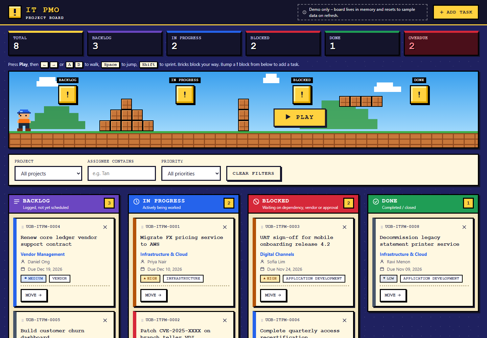

# Claude Code Training: Northbeam landing page and IT PMO Kanban board

Two small, dependency-free demo sites built with Claude Code and deployed on GitHub Pages.

| Page | Live URL | Source |
|---|---|---|
| Northbeam Software landing page (hero, three testimonials, enquiry form) | https://nsarno38.github.io/claudecodetraining/ | `index.html` |
| IT PMO Kanban board | https://nsarno38.github.io/claudecodetraining/kanban/ | `kanban/index.html` |

## Landing page

A fictitious software company site, designed with the `ui-ux-pro-max` agent skill (navy and blue "trust and authority" palette, serif headings, accessible focus states, reduced-motion support).

- Hero with call to action, proof stats, services and a sample project panel
- Three testimonial cards
- Enquiry form with inline validation, a "Sending…" state and success and warning messages
- Responsive from phone to desktop, with a skip link and keyboard-friendly controls

## Kanban board

A single-page Kanban board for a fictitious bank's internal IT PMO. Track IT projects across Backlog, In Progress, Blocked and Done.

- Four columns with live count badges and a summary strip (stacked below 768px)
- Task cards with ID, title, project, assignee, priority, due date, category and an overdue badge
- Drag and drop between columns, plus a keyboard-accessible "Move ▸" menu
- Add Task form with inline validation, optimistic UI and toast notifications
- Filters by project, assignee and priority; inline delete confirmation

## Run locally

No build step. Open `index.html` (landing page) or `kanban/index.html` (board) in a browser.

## Configuration

Both pages post to [FormSubmit](https://formsubmit.co) through a `FORMSUBMIT_ENDPOINT` constant near the top of their `<script>`. Set it to your own address to receive emails. FormSubmit sends a one-time activation email on first use, and messages only deliver after you confirm it. Until then the pages still work and show a warning. Don't commit a real address to a public repo.

## Project tooling

- `.claude/commands/publish-github.md`: a custom command that publishes the project (secret check, README, Pages, CI, About).
- `.claude/skills/`: project-level agent skills (`ui-ux-pro-max`, `retro`, `cybersecurity-analyst`).
- `.mcp.json`: Playwright MCP server for browser testing.
- `.github/workflows/ci.yml`: CI checks on every push.

## Notes

- Demo data only. Nothing is persisted: no localStorage, cookies or backend.
- Vanilla HTML, CSS and JavaScript, with no dependencies or external resources.
- Fictitious demos: not official systems of any organisation. Testimonials are sample text.
