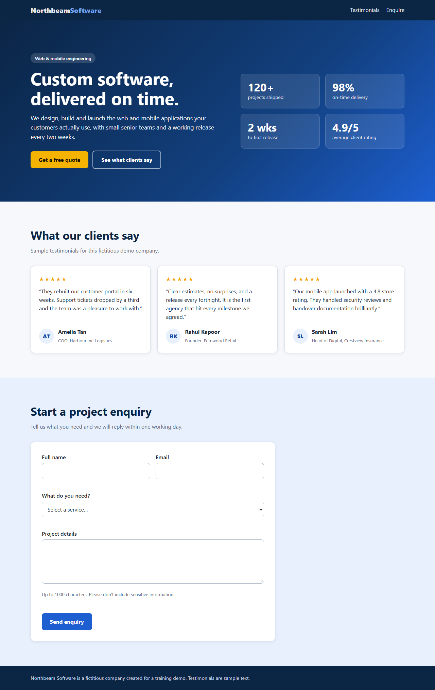

# IT PMO Kanban Board

A single-page Kanban board for a fictitious bank's internal IT PMO. Track IT projects across Backlog, In Progress, Blocked and Done.

**Live demo:** https://nsarno38.github.io/claudecodetraining/

**Also included:** a fictitious software-company landing page (hero, three testimonials, enquiry form) at https://nsarno38.github.io/claudecodetraining/site/ (source in `site/index.html`).

## Features

- Four columns with live count badges and a summary strip (side by side on desktop, stacked below 768px)
- Task cards with ID, title, project, assignee, priority, due date, category and an overdue badge
- Drag and drop between columns, plus a keyboard-accessible "Move ▸" menu
- Add Task form with inline validation, optimistic UI and toast notifications
- Filters by project, assignee and priority
- Inline delete confirmation (no browser dialogs)
- Optional email notification for new tasks via [FormSubmit](https://formsubmit.co)

## Run locally

No build step. Open `index.html` in a browser.

## Configuration

To receive new-task emails, set `FORMSUBMIT_ENDPOINT` near the top of the `<script>` in `index.html` to your own address. FormSubmit sends a one-time activation email on first use; notifications only deliver after you confirm it. Until then the board still works and shows a warning toast. Don't commit a real address to a public repo.

## Notes

- Demo data only. The board is not persistent and resets to seed data on every refresh (no localStorage, cookies or backend).
- Vanilla HTML, CSS and JavaScript, with no dependencies or external resources.
- Fictitious demo: not an official system of any organisation.

## Screenshots

### Landing page (`/site/`)

### Kanban board

